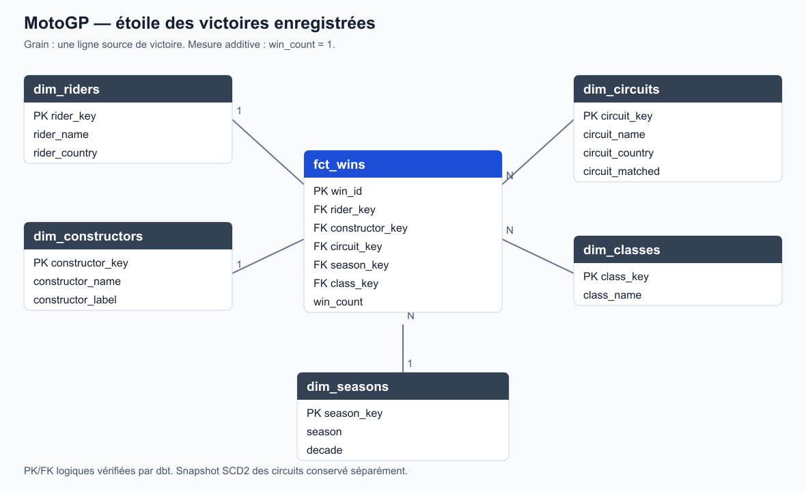
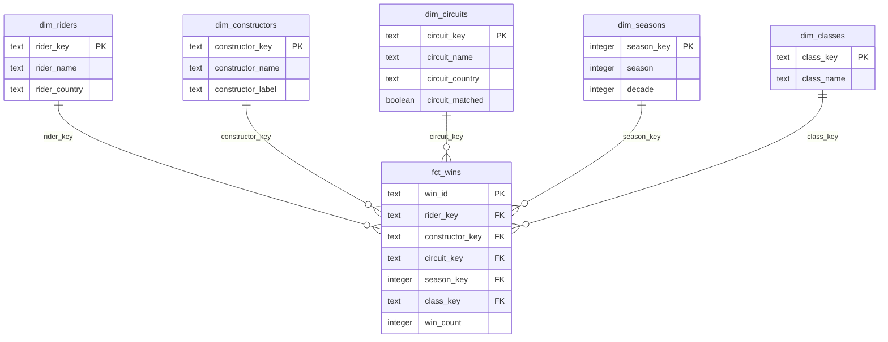

# Étoile des victoires enregistrées

Grain : une ligne de victoire enregistrée. Chaque fait se rattache à exactement un membre de chacune des cinq dimensions. `win_count = 1` est la mesure additive. Un constructeur absent dispose d'un membre « Constructeur inconnu ».

PK et FK représentent ici les clés logiques contrôlées par dbt. Des contraintes physiques ne sont pas créées. Les dimensions sont de type 1 et reconstruites à chaque build ; le snapshot SCD2 du référentiel circuits est séparé de l'étoile.
